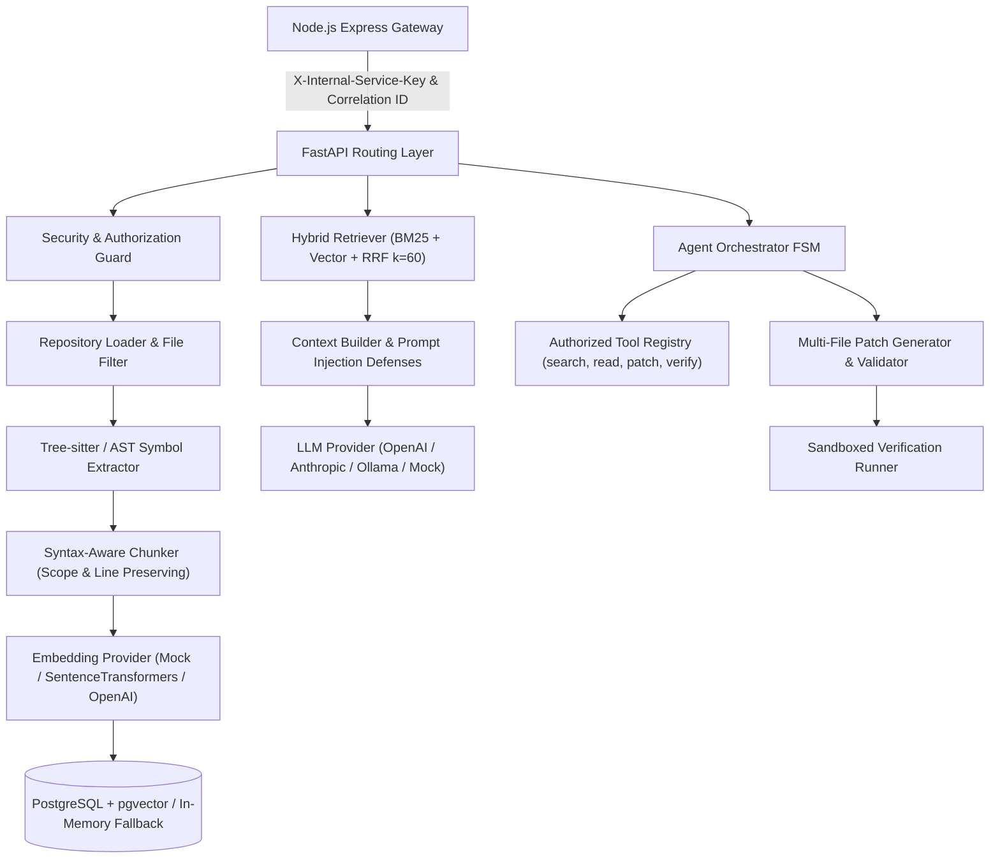

# CodePilot AI — AI & Agent Engineering Documentation 🧠

> **High-performance Python FastAPI microservice for repository intelligence, Tree-sitter code parsing, hybrid lexical/semantic retrieval, autonomous agent orchestration, multi-file patching, and safe sandboxed verification.**

---

## 1. Architecture & System Overview

The AI service operates as a decoupled repository intelligence layer communicating with the Node.js Express gateway and PostgreSQL with pgvector:



---

## 2. Finite-State Machine (FSM) Agent Loop

The agent orchestrator executes an explicit state machine:

$$\text{PLANNING} \longrightarrow \text{RETRIEVING} \longrightarrow \text{TOOL\_EXECUTION} \longrightarrow \text{EVALUATION} \longrightarrow \text{VERIFICATION} \longrightarrow \text{COMPLETED / FAILED}$$

1. **PLANNING**: Decomposes user instructions into a bounded plan and selects authorized tools.
2. **RETRIEVING**: Executes hybrid retrieval against indexed code chunks.
3. **TOOL_EXECUTION**: Runs authorized tools (`search_code`, `read_file`, `propose_patch`, `verify_code`).
4. **EVALUATION**: Checks evidence sufficiency and determines if additional tools or patches are needed.
5. **VERIFICATION**: Runs test commands (`npm test`, `pytest`) inside a bounded subprocess or disposable Docker sandbox.
6. **COMPLETED / FAILED**: Generates grounded results with citations or terminates on error.

---

## 3. Hybrid Retrieval with Reciprocal Rank Fusion (RRF)

CodePilot AI combines **lexical keyword search (BM25Plus)** with **dense semantic vector similarity**:

$$RRF(d) = \sum_{m \in M} \frac{1}{k + r_m(d)} \quad \text{where } k = 60$$

* **Lexical Search (`BM25Plus`)**: Accurately indexes programming identifiers (`calculate_metrics`, `verifyJwtToken`) and file paths without producing negative scores on small corpora.
* **Vector Search (`VectorSearchEngine`)**: Captures high-level concepts and natural language intent via normalized cosine similarity.
* **Reranker**: Deduplicates overlapping line ranges from the same file and enforces diversity limits.

---

## 4. Multi-File Patch Safety & Sandboxing

1. **Path Traversal Protection**: Rejects absolute paths and `..` directory escapes.
2. **Stale Hash Detection**: Validates SHA-256 hashes of original files before applying edits.
3. **Unified Diff Format**: Produces human-readable Git diffs.
4. **Sandboxed Verification**: Executes only allowlisted test commands with CPU/memory limits and timeout bounds.

---

## 5. REST API Endpoints

| Method | Endpoint | Description |
|--------|----------|-------------|
| `GET`  | `/health` | Diagnostic liveness probe |
| `GET`  | `/ready` | Database & vector store readiness probe |
| `POST` | `/api/v1/repositories/{id}/index` | Index codebase (snapshot path or virtual files) |
| `GET`  | `/api/v1/repositories/{id}/index-status` | Check indexing progress and chunk metrics |
| `POST` | `/api/v1/repositories/{id}/search` | Hybrid lexical/semantic code search |
| `POST` | `/api/v1/repositories/{id}/chat` | Grounded Q&A with source citations |
| `POST` | `/api/v1/repositories/{id}/agent-runs` | Autonomous agent execution run |
| `GET`  | `/api/v1/agent-runs/{id}` | Poll agent status and intermediate steps |
| `POST` | `/api/v1/repositories/{id}/patches` | Propose multi-file patch |
| `POST` | `/api/v1/patches/{id}/validate` | Validate patch safety and hashes |
| `POST` | `/api/v1/patches/{id}/apply` | Apply patch to workspace |
| `POST` | `/api/v1/patches/{id}/verify` | Run isolated test verification |
| `POST` | `/api/v1/repositories/{id}/generate-tests` | Generate unit & regression tests |

---

## 6. Running Tests & Development

### Automated Pytest Suite
Run the 20 automated unit and integration tests:
```bash
python -m pytest ai/tests -v
```

### Starting FastAPI Development Server
```bash
python -m uvicorn app.main:app --host 0.0.0.0 --port 8000 --reload
```
Interactive OpenAPI documentation will be accessible at: `http://localhost:8000/docs`

### PostgreSQL with pgvector Setup
Migrations are located in `app/migrations/001_initial_pgvector.sql`.
To start the containerized stack:
```bash
docker compose up -d postgres ai-service
```
