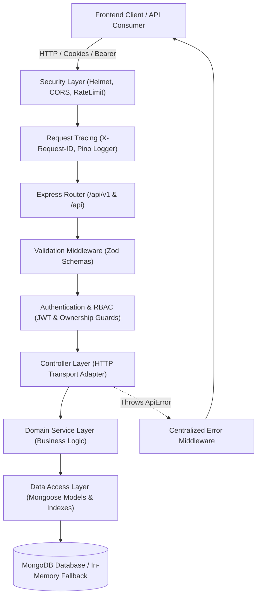

# CodePilot AI — Backend Architecture & Engineering Documentation ⚙️

> **Production-grade REST API backend built for large-scale codebase intelligence, repository indexing, AST symbol extraction, and AI code review workflows.**

---

## 1. Architectural Overview & System Design

The CodePilot AI backend is architected using a **strict layered pattern (N-Tier)** to enforce separation of concerns, high testability, domain isolation, and maintainability:



### Key Architectural Pillars
1. **Separation of Concerns**: Controllers never perform direct database queries; business rules and domain logic reside exclusively in `src/services/`.
2. **Predictable Operational Errors**: Handled uniformly via an `ApiError` class with standardized HTTP status codes and machine-readable error codes (`EMAIL_ALREADY_EXISTS`, `INVALID_CREDENTIALS`, `UNAUTHORIZED`, etc.).
3. **Structured Response Contract**: Every response adheres to the immutable envelope `{ success: true, message, data, requestId, pagination? }`.
4. **Resilient Local Execution**: Automatically connects to local MongoDB or seamlessly switches to embedded `mongodb-memory-server` in non-production environments when local MongoDB is not running.

---

## 2. Placement Interview Deep Dive (SDE Concepts)

### A. The Node.js Event Loop & I/O Starvation Prevention
- **Concept**: Node.js operates on a single-threaded event loop (libuv). Synchronous computational tasks (e.g., parsing massive 50MB files or complex AST traversal) block the main thread and starve concurrent incoming HTTP requests.
- **Implementation in CodePilot**:
  - File reading and repository operations are handled asynchronously.
  - Resource-intensive AST parsing and token chunking are delegated to asynchronous streams and background worker jobs (`BackgroundJob` collection) rather than running synchronously inside request-response cycles.
  - Bcrypt hashing uses an asynchronous thread pool execution (`bcrypt.hash(password, 12)`).

### B. Dual Authentication Strategy (Cookies vs. Bearer Tokens)
- **Concept**:
  - **HTTP-Only, SameSite Cookies**: Immune to client-side XSS attacks since JavaScript cannot access `document.cookie`. Protects browser sessions.
  - **Bearer Tokens in Authorization Headers**: Essential for mobile clients, third-party CLI tools (`agy`), and server-to-server integrations.
- **Implementation**: The `authenticate` middleware inspects `req.cookies.token` first, falling back to `Authorization: Bearer <token>`, giving maximum client versatility without sacrificing web security.

### C. MongoDB Indexing Strategy & Compound Keys
- **Indexes in CodePilot**:
  - `Repository`: Compound index `{ ownerId: 1, name: 1 }` with `{ unique: true }` enforces per-user repository name uniqueness and prevents full-collection scans ($O(1)$ vs $O(N)$).
  - `Conversation`: Compound index `{ ownerId: 1, updatedAt: -1 }` accelerates user chat thread listings sorted by recency.
  - `Message`: Compound index `{ conversationId: 1, createdAt: 1 }` guarantees rapid message thread reconstruction.
- **Preventing the 16MB BSON Document Limit**: Messages are stored in a dedicated `Message` collection referenced by `conversationId`, preventing chat threads from exceeding MongoDB's 16MB single-document constraint.

---

## 3. Directory Layout

```
backend/
├── src/
│   ├── config/             # Environment, Logger, Database connection
│   │   ├── database.js     # Mongoose connection with MemoryServer fallback
│   │   ├── env.js          # Zod-validated runtime environment variables
│   │   └── logger.js       # Pino structured logger with credential redaction
│   ├── controllers/        # HTTP transport handlers
│   │   ├── auth.controller.js
│   │   ├── conversation.controller.js
│   │   ├── job.controller.js
│   │   ├── project.controller.js
│   │   ├── repository.controller.js
│   │   ├── review.controller.js
│   │   └── settings.controller.js
│   ├── middleware/         # Security, validation, and error pipeline
│   │   ├── authenticate.js
│   │   ├── authorize.js
│   │   ├── error-handler.js
│   │   ├── not-found.js
│   │   ├── rate-limit.js
│   │   ├── request-id.js
│   │   └── validate.js
│   ├── models/             # Mongoose schemas & indexes
│   ├── routes/             # Express API routes
│   ├── services/           # Core domain business logic
│   ├── utils/              # ApiError, ApiResponse, asyncHandler, token helpers
│   ├── app.js              # Express app configuration & middleware mounts
│   └── server.js           # Server bootstrap & graceful shutdown lifecycle
├── tests/                  # Integration tests (Vitest + Supertest)
│   ├── auth.test.js
│   ├── conversations.test.js
│   ├── health.test.js
│   ├── repositories.test.js
│   ├── reviews_jobs_settings.test.js
│   └── setup.js
├── Dockerfile              # Multi-stage production container build
├── package.json
└── vitest.config.js
```

---

## 4. REST API Reference

All endpoints are accessible via `/api/v1` and aliased under `/api`.

### Authentication (`/api/v1/auth`)
| Method | Endpoint | Description | Auth Required |
|--------|----------|-------------|---------------|
| `POST` | `/auth/register` | Register a new user account | No (Rate-limited) |
| `POST` | `/auth/login` | Authenticate with email/password | No (Rate-limited) |
| `POST` | `/auth/logout` | Clear HTTP-only session cookie | No |
| `GET`  | `/auth/me` | Fetch authenticated user profile | Yes |
| `PATCH`| `/auth/profile` | Update profile information | Yes |

### Repositories (`/api/v1/repositories`)
| Method | Endpoint | Description | Auth Required |
|--------|----------|-------------|---------------|
| `GET`  | `/repositories` | List user repositories (auto-seeds default if empty) | Yes |
| `POST` | `/repositories` | Import a new git repository | Yes |
| `GET`  | `/repositories/:id` | Get repository details | Yes |
| `GET`  | `/repositories/:id/files` | Get virtual file tree | Yes |
| `GET`  | `/repositories/:id/files/:fileId` | Get file content | Yes |
| `POST` | `/repositories/:id/reindex` | Trigger repository re-indexing job | Yes |
| `DELETE`| `/repositories/:id` | Delete repository | Yes |

### Conversations & AI Chat (`/api/v1/conversations`)
| Method | Endpoint | Description | Auth Required |
|--------|----------|-------------|---------------|
| `GET`  | `/conversations` | List conversation threads | Yes |
| `POST` | `/conversations` | Create a new conversation | Yes |
| `GET`  | `/conversations/:id` | Get conversation with messages | Yes |
| `PATCH`| `/conversations/:id` | Rename conversation thread | Yes |
| `DELETE`| `/conversations/:id` | Delete conversation thread | Yes |
| `POST` | `/conversations/:id/messages` | Dispatch message & generate assistant reply | Yes |

### Code Reviews (`/api/v1/reviews`)
| Method | Endpoint | Description | Auth Required |
|--------|----------|-------------|---------------|
| `GET`  | `/reviews` | List code reviews | Yes |
| `GET`  | `/reviews/:id` | Get review details and diff | Yes |
| `PATCH`| `/reviews/:id/status` | Update status (`approved`, `rejected`, `pending`) | Yes |
| `POST` | `/reviews/:id/comments` | Add comment to review thread | Yes |

### Background Jobs (`/api/v1/jobs`)
| Method | Endpoint | Description | Auth Required |
|--------|----------|-------------|---------------|
| `GET`  | `/jobs` | List indexing & embedding background jobs | Yes |
| `GET`  | `/jobs/:id` | Get job progress and event logs | Yes |
| `POST` | `/jobs/:id/retry` | Trigger job retry execution | Yes |

### Settings (`/api/v1/settings`)
| Method | Endpoint | Description | Auth Required |
|--------|----------|-------------|---------------|
| `GET`  | `/settings` | Retrieve user preferences (theme, font, tab size) | Yes |
| `PATCH`| `/settings` | Update user preferences | Yes |

---

## 5. Development & Testing

### Running Tests
Execute the automated test suite powered by Vitest and Supertest:
```bash
npm test
```
All 19 integration tests execute with zero configuration using embedded in-memory MongoDB.

### Running Dev Server
```bash
npm run dev
```

### Production Docker Container
```bash
docker compose up --build
```
This boots up:
- `mongodb` on port `27017`
- `backend` on port `5000`
- `frontend` on port `5173`
